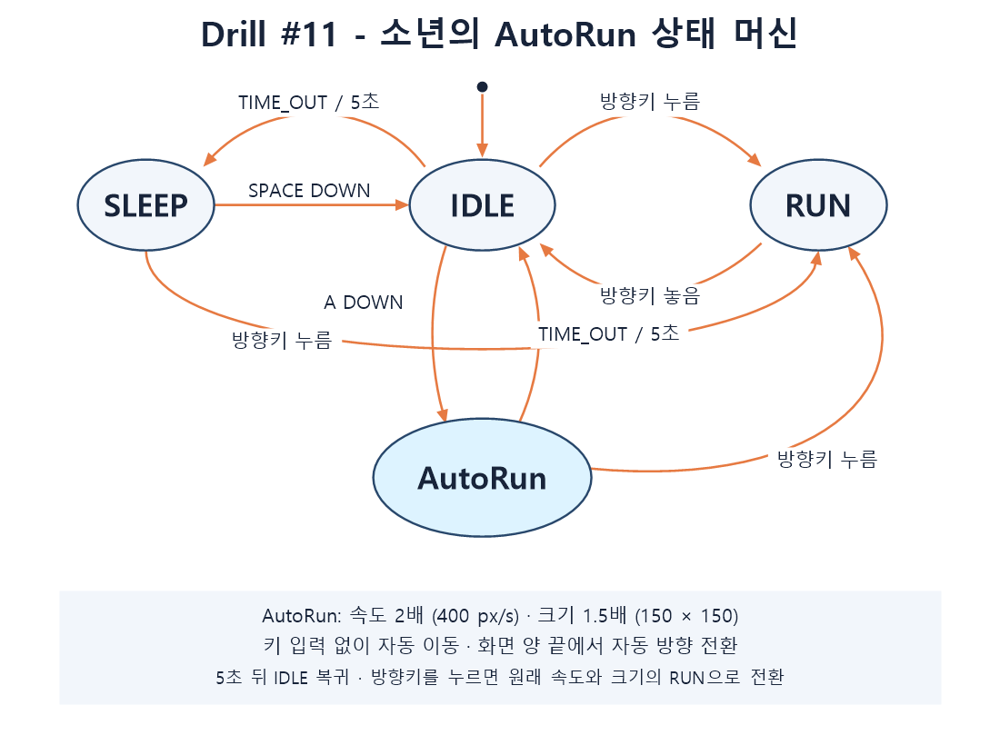

# PRD — LEC 13 / Drill 11: 소년 상태 머신과 AutoRun

- 작성일: 2026-10-28
- 대상 폴더: `C:\Users\tedu0\Desktop\대학\2D-GP\lec 13`
- 작업 저장소: `https://github.com/bbbboxvader/lec-13`
- 이전 원본: `C:\Users\tedu0\2DGP-2023180016`
- 구현 위치: 이 `lec 13` 저장소의 루트 폴더
- 상태: 구현 및 동작 검증 완료

## 1. 목표

Pico2D 화면의 소년을 `transitions.Machine`으로 제어한다. IDLE, SLEEP,
RUN을 유지하면서 별도의 `AutoRun` 상태 클래스를 추가한다. 사용자는 A키로
자동 이동을 시작하고, 방향키로 일반 달리기에 복귀할 수 있어야 한다.

## 2. 실행 환경

- Python과 `pico2d`, `transitions` 라이브러리를 사용한다.
- 실제 실행 검증 환경은 Windows의 Python 3.14이다.
- 기본 캔버스는 800×600이며, 이동 경계는 실제 캔버스 너비로 계산한다.
- 이미지는 `animation_sheet.png`, `grass.png`를 사용한다.
- 애니메이션은 8프레임을 10 FPS로 반복한다.

```powershell
python -m pip install -r requirements.txt
python main.py
```

명령은 이 문서가 있는 `lec 13` 폴더에서 실행한다.

## 3. 기능 요구사항

| ID | 요구사항 | 완료 기준 |
| --- | --- | --- |
| FR-01 | 최초 상태는 IDLE이다. | 소년이 초기 위치 `(400, 90)`에서 IDLE 애니메이션을 반복한다. |
| FR-02 | IDLE에서 5초가 지나면 SLEEP으로 전환한다. | 경과 시간이 5초 미만이면 IDLE이고, 5초 이상인 첫 업데이트에서 SLEEP이 된다. |
| FR-03 | SLEEP에서 Space를 누르면 IDLE로 돌아간다. | 애니메이션과 IDLE 타이머가 다시 시작된다. |
| FR-04 | IDLE 또는 SLEEP에서 방향키를 누르면 RUN으로 전환한다. | 왼쪽과 오른쪽을 하나의 RUN 상태와 방향 값으로 처리한다. |
| FR-05 | RUN은 누른 방향으로 일반 달리기를 수행한다. | 속도는 200 px/s이며, 모든 방향키를 놓으면 IDLE로 돌아간다. |
| FR-06 | IDLE에서 A키를 누르면 AutoRun을 시작한다. | `AutoRun` 클래스의 진입 동작이 실행되고 이후 입력 없이 이동한다. |
| FR-07 | AutoRun은 속도와 크기가 증가한다. | 속도는 RUN의 2배인 400 px/s, 크기는 기본 100×100의 1.5배인 150×150이다. |
| FR-08 | AutoRun은 화면 양 끝에서 자동으로 방향을 바꾼다. | 확대된 소년이 화면 안에 머무르며, 경계를 넘어 이동할 거리도 반사 계산에 포함한다. |
| FR-09 | AutoRun은 5초 뒤 IDLE로 돌아간다. | 5초 이상인 첫 업데이트에서 자동 이동이 끝나고 원래 크기와 IDLE 타이머로 복귀한다. |
| FR-10 | AutoRun 중 방향키는 자동 이동을 취소한다. | 누른 방향의 RUN으로 즉시 전환하며 크기와 이동 속도가 일반 RUN으로 복구된다. |
| FR-11 | A키 반복 입력은 AutoRun을 연장하거나 재시작하지 않는다. | 이미 AutoRun 중인 A 입력은 무시하고, OS의 키 반복 입력으로 IDLE에서 다시 시작하지 않는다. |
| FR-12 | 상태 그림을 이미지 파일로 제공한다. | `state_diagram.png`가 실행 폴더와 Git 저장소에 포함된다. |

## 4. 상태와 전환

| 현재 상태 | 조건 또는 입력 | 다음 상태 |
| --- | --- | --- |
| 시작 | 게임 초기화 | IDLE |
| IDLE | IDLE 진입 후 5초 이상 경과 | SLEEP |
| SLEEP | Space 키 누름 | IDLE |
| IDLE | 왼쪽/오른쪽 방향키 누름 | RUN |
| SLEEP | 왼쪽/오른쪽 방향키 누름 | RUN |
| RUN | 누르고 있던 방향키를 모두 놓음 | IDLE |
| IDLE | 새로운 A 키 누름 | AutoRun |
| AutoRun | AutoRun 진입 후 5초 이상 경과 | IDLE |
| AutoRun | 왼쪽/오른쪽 방향키 누름 | RUN |

AutoRun에서 화면 경계에 도달하면 방향만 반전하며 AutoRun 상태를 유지한다.



