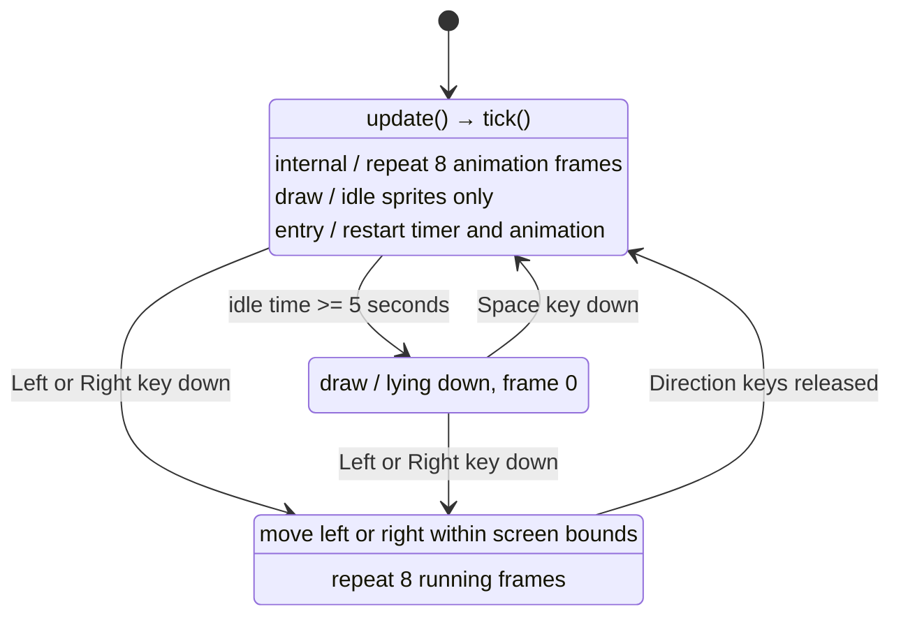

# Boy IDLE / SLEEP / RUN state machine

`transitions.Machine` starts in `IDLE`. Each `update()` checks the elapsed idle
time with a monotonic clock. Before five seconds, the eight idle frames repeat.
At five seconds or later, the boy enters `SLEEP` and lies down using a rotated
idle sprite. Space key down wakes him into `IDLE`, resetting both the timer and
the animation. Pressing Left or Right in either `IDLE` or `SLEEP` enters the
single `RUN` state. Running uses sprite row 100 (right) or 0 (left), moving at
200 pixels/second. IDLE and RUN animations play at 10 frames/second.

The latest pressed arrow controls direction when both are held. Releasing it
resumes the other held arrow; releasing all arrows returns to `IDLE` and restarts
the five-second timer. OS key repeat does not change priority. The whole sprite
stays inside the canvas (center x between 50 and canvas width minus 50). Space in
IDLE or RUN has no effect. Automatic transitions are disabled.
