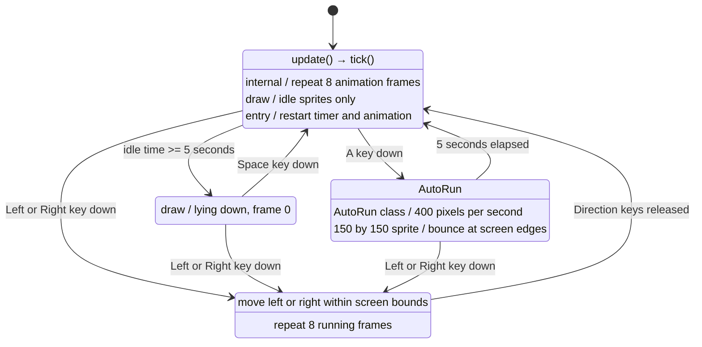

# Boy IDLE / SLEEP / RUN / AutoRun state machine

`transitions.Machine` starts in `IDLE`. Each `update()` checks the elapsed idle
time with a monotonic clock. Before five seconds, the eight idle frames repeat.
At five seconds or later, the boy enters `SLEEP` and lies down using a rotated
idle sprite. Space key down wakes him into `IDLE`, resetting both the timer and
the animation. Pressing Left or Right in either `IDLE` or `SLEEP` enters the
single `RUN` state. Running uses sprite row 100 (right) or 0 (left), moving at
200 pixels/second. IDLE and RUN animations play at 10 frames/second.

The latest pressed arrow controls direction when both are held. Releasing it
resumes the other held arrow; releasing all arrows returns to `IDLE` and restarts
the five-second timer. OS key repeat does not change priority. The whole sprite
stays inside the canvas (center x between 50 and canvas width minus 50). Space in
IDLE or RUN has no effect. Automatic transitions are disabled.

`auto_run.py` defines the dedicated `AutoRun` state class. A fresh A key press in
IDLE enters this state. The boy moves automatically at twice normal RUN speed
(400 pixels/second) and grows from 100 to 150 pixels while keeping his feet at
the same height. At either screen edge, movement reflects back into the canvas,
including any overshoot during a slow frame. After five seconds the state returns
to IDLE and the ordinary size is restored. Either direction key cancels AutoRun
into ordinary RUN immediately, at normal size and speed, in that key's direction.
Holding A does not restart or extend AutoRun. A in SLEEP or RUN has no effect.
